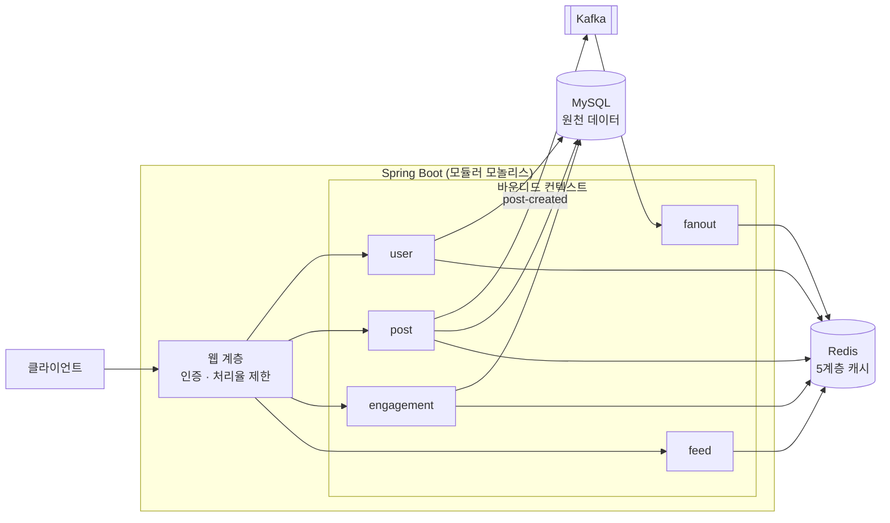

# Newsfeed — 대규모 뉴스피드 시스템 설계 & 구현

『가상 면접 사례로 배우는 대규모 시스템 설계 기초』 11장 "뉴스피드 시스템 설계"를 **설계 문서로만 끝내지 않고 실제로 동작하는 백엔드**로 구현한 학습 프로젝트입니다.
책이 그리는 컴포넌트(웹 서버, 팬아웃 서비스·워커, 메시지 큐, 5계층 캐시)를 Spring Boot · Redis · Kafka · MySQL로 재현했고, **클린 아키텍처 + 바운디드 컨텍스트**로 경계를 나눠 이후 마이크로서비스로 분리할 수 있게 해 두었습니다.

## 핵심 아이디어

| 주제 | 이 프로젝트의 답 |
|------|------------------|
| 피드를 언제 만드나? | **하이브리드 팬아웃** — 일반 사용자는 발행 시점에 팔로워 피드 캐시로 push(fanout-on-write), 팔로워가 임계값을 넘는 celebrity는 push를 생략하고 조회 시 pull(fanout-on-read)해 병합 |
| 발행이 느려지지 않으려면? | 발행 API는 DB 저장 + 이벤트 발행까지만 하고, 팬아웃은 **Kafka 컨슈머(워커)가 비동기**로 처리 (최종적 일관성) |
| 캐시는 어떻게 쌓나? | 책의 **5계층 전부 구현** — 뉴스피드 / 콘텐츠 / 소셜 그래프 / 행동 / 횟수 |
| 캐시가 틀어지면? | DB 행이 원천(source of truth), 캐시와 횟수 컬럼은 파생값 → look-aside 재적재로 **자가 치유** |
| 경계는 어떻게 지키나? | **ArchUnit 테스트**가 계층 방향과 컨텍스트 간 접근을 빌드 단계에서 강제 |

## 아키텍처



### 컨텍스트와 책임

| 컨텍스트 | 책임 | 소유하는 캐시 |
|----------|------|---------------|
| `user` | 사용자, 팔로우 관계 | `user:{id}` `cnt:user:{id}` `following:{id}` |
| `post` | 포스트 발행·조회, 좋아요/답글 **횟수의 소유자**, `post-created` 이벤트 발행 | `post:{id}` `author-posts:{id}` `cnt:post:{id}` |
| `engagement` | 좋아요, 답글 | `post-likers:{id}` `post-replies:{id}` |
| `fanout` | `post-created` 소비 → 팔로워 피드 캐시에 push (celebrity는 생략) | `feed:{id}` (쓰기) |
| `feed` | 뉴스피드 조회 — push분 + celebrity pull분 병합 | `feed:{id}` (읽기) |

컨텍스트끼리는 **서로의 `application.port.in`(공개 유스케이스)만** 호출할 수 있고, 실제 의존은 아래가 전부입니다.

```
engagement → post     GetPostsByIdsUseCase, UpdatePostCountsUseCase
fanout     → user     GetFollowCountsUseCase, GetFollowerIdsUseCase
feed       → user     GetCelebrityFolloweesUseCase, GetUserSummaryUseCase
feed       → post     GetPostsByIdsUseCase, GetRecentPostsByAuthorUseCase
feed       → engagement GetLikedPostIdsUseCase
post ⇢ (Kafka 토픽) ⇢ fanout     ← 클래스 의존 없음, 토픽 이름과 JSON 스키마만 공유
```

### 컨텍스트 내부 구조 (클린 아키텍처)

```
com.newsfeed.{context}/
├── domain/              순수 Java (Spring/JPA 의존 금지)
├── application/
│   ├── port/in/         유스케이스 인터페이스 — 다른 컨텍스트에 공개되는 유일한 계약
│   ├── port/out/        저장소·캐시·이벤트 발행 인터페이스
│   └── service/         유스케이스 구현
└── adapter/
    ├── in/web, in/messaging     REST 컨트롤러, Kafka 컨슈머
    └── out/persistence, redis, kafka, event    JPA / Redis / Kafka / Spring 이벤트 구현체
```

## 기술 스택

Java 21 · Spring Boot 4.1 · Spring Data JPA · Flyway · MySQL 8.4 · Redis 7.4 · Kafka 4.0 (KRaft) · ArchUnit · Testcontainers · Docker Compose

## 실행 방법

필요한 것: **JDK 21** (Gradle 실행에는 17+), **Docker**.

```bash
docker compose up -d --wait     # MySQL · Redis · Kafka 기동
./gradlew bootRun               # http://localhost:8080
```

> 8080이 이미 사용 중이면 `./gradlew bootRun --args='--server.port=8081'`

### 5분 데모

```bash
BASE=http://localhost:8080

# 1) 사용자 두 명 생성, bob이 alice를 팔로우
#    (DB가 비어 있다는 가정 — alice=1, bob=2. 이미 데이터가 있다면 응답의 id로 바꿔서 사용)
curl -s -X POST $BASE/api/users -H 'Content-Type: application/json' -d '{"username":"alice","displayName":"Alice"}'
curl -s -X POST $BASE/api/users -H 'Content-Type: application/json' -d '{"username":"bob","displayName":"Bob"}'
curl -s -X POST $BASE/api/users/1/follow -H 'X-USER-ID: 2'

# 2) alice가 포스트 발행 → Kafka → 팬아웃 워커가 bob의 피드 캐시에 push
curl -s -X POST $BASE/api/posts -H 'X-USER-ID: 1' -H 'Content-Type: application/json' -d '{"content":"첫 포스트"}'
docker exec newsfeed-redis redis-cli zrange feed:2 0 -1 withscores     # 팬아웃 결과 직접 확인

# 3) bob의 뉴스피드 조회, 좋아요·답글 후 다시 조회
curl -s "$BASE/api/feed?size=20" -H 'X-USER-ID: 2'
curl -s -X POST $BASE/api/posts/1/like -H 'X-USER-ID: 2'
curl -s -X POST $BASE/api/posts/1/replies -H 'X-USER-ID: 2' -H 'Content-Type: application/json' -d '{"content":"좋은 글이네요"}'
curl -s "$BASE/api/feed?size=20" -H 'X-USER-ID: 2'    # likeCount=1, replyCount=1, likedByMe=true
```

### API 요약

| 메서드 | 경로 | 설명 |
|--------|------|------|
| POST | `/api/users` | 사용자 생성 (인증 불필요) |
| GET | `/api/users/{id}` | 사용자 조회 (+ 팔로워/팔로잉 수) |
| POST / DELETE | `/api/users/{id}/follow` | 팔로우 / 언팔로우 |
| POST | `/api/posts` | 포스트 발행 |
| GET | `/api/users/{id}/posts` | 작성자별 포스트 목록 (커서) |
| POST / DELETE | `/api/posts/{id}/like` | 좋아요 / 취소 (멱등) |
| POST / GET | `/api/posts/{id}/replies` | 답글 작성 / 목록 (커서) |
| GET | `/api/feed` | 뉴스피드 (커서) |

인증은 단순화를 위해 `X-USER-ID` 헤더를 사용합니다. 전체 명세는 [docs/04-api-spec.md](docs/04-api-spec.md).

## 테스트

```bash
./gradlew test      # Docker 필요 (Testcontainers가 MySQL·Redis·Kafka를 띄움)
```

**84개 테스트, 모두 통과.**

| 종류 | 대상 |
|------|------|
| 아키텍처 (ArchUnit) | 계층 방향, domain의 프레임워크 무의존, 컨텍스트 간 `port.in` 외 접근 금지 |
| 유스케이스 단위 (Mockito) | 팔로우·좋아요의 멱등성과 동시성 경합, 하이브리드 팬아웃 분기, 피드 병합·중복 제거·커서, look-aside 캐시/DB 폴백, 횟수 조립 |
| E2E (Testcontainers) | 발행 → Kafka → 팬아웃 → 피드 조회 전체 파이프라인, celebrity push 생략 + pull 병합, 좋아요·답글이 횟수와 `likedByMe`에 반영 |

## 개발 중 실제로 겪고 해결한 문제들

| 문제 | 원인 | 해결 |
|------|------|------|
| 피드 페이지네이션이 항상 같은 페이지 반환 | cursor(13자리 epoch millis)에서 `1e-6`을 빼는 방식이 `double` 유효자릿수 한계로 반올림되어 "제외"가 무력화 | 정수 score 간격(1)의 절반인 `0.5`로 수정 + 회귀 테스트 |
| Redis 파이프라인 `ClassCastException` | `RedisCallback`에서 커넥션을 `StringRedisConnection`으로 캐스팅 — Actuator 관측 계측이 커넥션을 프록시로 감싸 캐스팅 불가 | 커넥션을 직접 다루지 않는 `SessionCallback` + `RedisOperations`로 교체 |
| 컨텍스트 경계 누수 | `fanout`이 `user.domain.FollowCounts`를 직접 참조 (port.in 반환 타입도 공개 계약의 일부) | ArchUnit이 검출 → 반환 타입을 `int`/전용 뷰 레코드로 좁힘, 규칙 보강 |
| 좋아요를 눌러도 횟수가 0 | `Post`에 박제된 횟수가 TTL 1시간짜리 콘텐츠 캐시에 같이 담겨 갱신 안 됨 | 불변 콘텐츠(`Post`)와 가변 횟수(`PostCounts`)를 별도 캐시로 분리 |
| 앱 부팅 실패 (`ConflictingBeanDefinitionException`) | 두 컨텍스트에 같은 이름의 `SpringEventPublisherAdapter` | 컨텍스트 접두어로 클래스명 구분 |
| 동시 중복 팔로우 시 횟수 이중 증가 위험 | 복합키 엔티티의 `save()`가 INSERT가 아닌 merge로 동작 | `Persistable.isNew()=true` + `saveAndFlush`, 상호 팔로우 데드락은 id 오름차순 잠금으로 예방 |

## 알려진 한계와 다음 단계

- **이벤트 유실 가능성**: `post-created` 발행은 DB 커밋 후 직접 Kafka로 보냅니다. 커밋 직후 장애가 나면 해당 포스트는 팬아웃되지 않습니다 → 승격 기준과 **Transactional Outbox** 전환 방법은 [docs/05-msa-roadmap.md](docs/05-msa-roadmap.md)
- celebrity 포스트의 **깊은 페이지네이션 미지원** (`author-posts` 캐시는 최근 100개), 언팔로우 시 피드 캐시 소급 정리 없음, 조회 경로의 건별 Redis 왕복 → [docs/03-detailed-design.md §3.4](docs/03-detailed-design.md)
- 인증은 헤더 신뢰 방식, 처리율 제한은 고정 윈도 — 각각 JWT / 토큰 버킷으로 교체 지점이 한 곳에 격리되어 있음
- 이미지·비디오(CDN), 알림, 랭킹, 다중 리전은 범위 밖
- **마이크로서비스 분리**: Gradle 멀티모듈 → 팬아웃 워커(인바운드가 Kafka뿐이라 첫 추출 대상) → 나머지 서비스 → DB 분리 순서의 로드맵

## 문서

| 문서 | 내용 |
|------|------|
| [01-requirements](docs/01-requirements.md) | 요구사항, 규모 추정 |
| [02-high-level-design](docs/02-high-level-design.md) | 개략적 설계, 발행/조회 시퀀스 |
| [03-detailed-design](docs/03-detailed-design.md) | 팬아웃 전략, 5계층 캐시, 트레이드오프, 구현 확정 사항 |
| [04-api-spec](docs/04-api-spec.md) | REST API · Kafka 이벤트 명세 |
| [05-msa-roadmap](docs/05-msa-roadmap.md) | 마이크로서비스 분리 로드맵, Outbox 승격 기준 |
